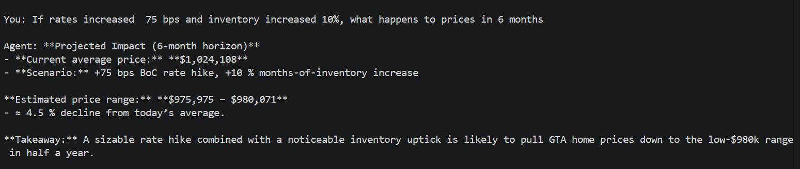
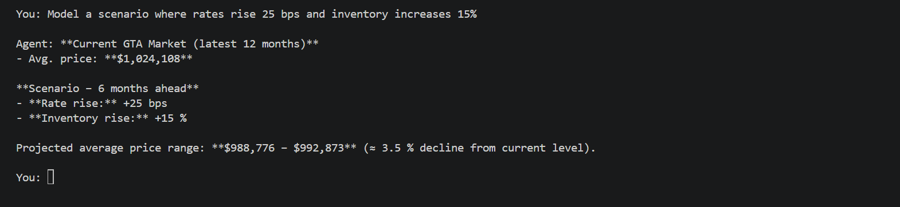
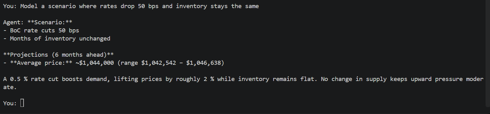

# GTA Market Analyst

**Market Trend Analyst + Scenario Modeler**

A simple LangGraph agent focused on GTA/Toronto housing market analysis and "what-if" modeling.

Data is compiled from publicly published TRREB Market Watch reports and Bank of Canada statistics.

## Features

- Interactive chat interface
- Historical market stats (average price, sales, inventory, sales-to-new-listings ratio, etc.)
- Rule-based scenario modeling (interest rate changes + inventory changes)
- Uses clean monthly aggregates from public TRREB-style reports

## Quick Start

1. **Clone the repo**

   ```bash
   git clone https://github.com/<your-username>/gta-market-analyst.git
   cd gta-market-analyst
   ```

2. **Create a virtual environment and install dependencies**

   ```bash
   python -m venv venv
   source venv/bin/activate        # On Windows: venv\Scripts\activate
   pip install langchain langchain-groq langgraph pandas python-dotenv
   ```

3. **Create a `.env` file in the project root**

   ```env
   GROQ_API_KEY=your_key_here
   ```

4. **Run the agent**

   ```bash
   python agent.py
   ```

## Demo

**Scenario modeling**







## Example Questions

- *Summarize GTA market conditions over the last 6 months.*
- *How has the average price changed from October 2025 to October 2026?*
- *If rates drop 50 bps and inventory stays elevated, what is a reasonable price range in 6 months?*
- *What happened to the sales-to-new-listings ratio recently?*

## Data

`data/gta_monthly.csv` contains monthly aggregates:

| Column | Description |
|---|---|
| Average price | Average sale price across the GTA |
| Sales | Number of completed sales |
| New listings | Listings added during the month |
| Active listings | Listings available at month end |
| Months of inventory | Active listings ÷ monthly sales |
| Sales-to-new-listings ratio | Sales ÷ new listings (market balance indicator) |
| Days on market | Average days before a sale |
| BoC overnight rate | Bank of Canada policy rate |

## Tech Stack

- [LangChain](https://www.langchain.com/) / [LangGraph](https://www.langchain.com/langgraph) (`create_agent`)
- [Groq](https://groq.com/)
- [Pandas](https://pandas.pydata.org/)
- Python
